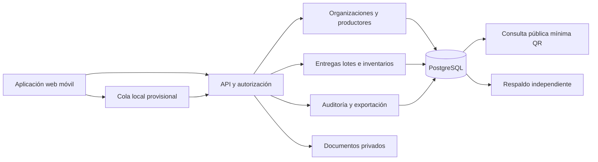

# Arquitectura del producto de software

Versión 2.0 · 4 de noviembre de 2026 · Alcance tecnológico aprobado por el equipo. Metas, adquisiciones y servicios todavía sujetos a validación.

## Límites de responsabilidad

CooperaLote desarrolla, despliega y mantiene el software. Las organizaciones usuarias producen, compran, procesan y venden miel; sus responsables registran calidad y autorizan movimientos. El sistema almacena evidencia y aplica permisos, sin emitir certificaciones ni ordenar pagos bancarios. No existe organización piloto confirmada.

## Capas y módulos

Monolito modular propuesto. Prototipo: navegación del flujo esencial con datos sintéticos y límites visibles. MVP: persistencia, permisos, validación, auditoría y exportación. Fase posterior: costos, ventas y cálculo de liquidaciones de los usuarios, si su necesidad se confirma. No se desarrolla integración bancaria ni fiscal en el MVP.

| Entidad | Campos / relación | Regla |
|---|---|---|
| Organización/usuario | ID, organización, rol y estado | Contexto de organización validado por servidor |
| Productor/entrega | Identificador, fecha, kg y documento | Datos mínimos, decimales; ajuste trazable tras confirmar |
| Lote/origen | Padres, aportaciones en kg, estado | Genealogía muchos a muchos; impedir ciclos y doble conteo |
| Movimiento | Lote, tipo, cantidad, actor y comprobante | Transacción atómica; impedir stock negativo |
| Evidencia | Tipo, fecha, autor y archivo privado | Dictamen pertenece al operador responsable, no al software |
| Evento de auditoría | Actor, hora, operación y referencia | Historial de cambios y ajustes autorizado |

Balance de la organización: entradas = salidas + pérdidas documentadas + existencias, por periodo y unidad coherentes. Una discrepancia sin explicación no se transforma automáticamente en merma. Los volúmenes de lotes padres e hijos no se suman como nueva producción.

## Seguridad y conectividad

Permisos por organización y rol, sesión segura, TLS, protección CSRF, límites de solicitudes, secretos fuera del repositorio y archivos privados. Vista QR sólo con identificador público, producto y procedencia general autorizada, sin domicilios ni teléfonos de productores. Pruebas con dos organizaciones ficticias antes de alta real; el filtro de interfaz no basta.

PostgreSQL permite políticas por fila como defensa adicional. Usar rol de aplicación sin propiedad de tablas ni BYPASSRLS; pruebas de aislamiento deben abarcar API, archivos, exportaciones y tareas de fondo. Véase [tecnologías](tecnologias.md).

Captura offline: UUID e idempotencia por organización, cola pendiente/rechazada/confirmada y revalidación al sincronizar. Conflictos de stock se revisan, no se resuelven con el último cambio. No almacenar datos sensibles innecesarios en dispositivos compartidos. Probar pérdida de conexión y repetición del envío.

## Continuidad y aceptación

Objetivos propuestos: RPO de 24 horas y RTO de 8 horas, demostrados mediante restauración mensual antes de comprometer un SLA. Separar desarrollo, pruebas y piloto; nunca reutilizar datos personales reales en demostraciones públicas.

Antes de piloto real: validar aislamiento, restauración, genealogía, bloqueo de operaciones no autorizadas, exportación y sincronización. Una prueba simulada aprobada acredita comportamiento técnico, no adopción ni mejora productiva real.
