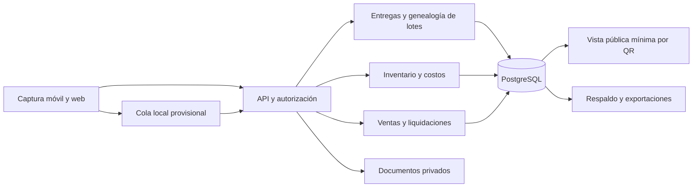

# Arquitectura operativa y tecnológica

Versión 1.0 · Diseño propuesto, no sistema implementado.

## Cadena operativa y responsabilidades

1. Comercial acuerda volumen, precio, condiciones de calidad y pago con cada productor.
2. Recepción registra pesaje neto, recipiente, proveedor, fecha y muestra; asigna estado de cuarentena.
3. Calidad verifica criterios del procedimiento y resultados requeridos; acepta, rechaza o mantiene retenido. Producción no puede liberar su propio lote sin revisión.
4. Producción acondiciona únicamente lotes autorizados, documenta parámetros del proceso, mezclas, fraccionamiento y mermas.
5. Envasado identifica lote, cantidad, material, etiqueta y unidades; calidad autoriza venta.
6. Almacén registra entradas/salidas y ventas por lote. Administración concilia cobros y liquidaciones.
7. Ante incidencia, calidad bloquea lotes y descendientes, identifica compradores y ejecuta retiro documentado.

Separar físicamente recepción/cuarentena, proceso, material limpio, producto liberado y devoluciones. Evaluar flujos sanitarios y almacenamiento antes de comprar equipo. No se fija una receta térmica genérica: el responsable técnico valida el proceso para conservar especificaciones.

## Arquitectura lógica

Monolito modular con una API y una base relacional. Iniciar con una organización y diseñar claves de organización desde el primer día. La incorporación de terceros queda condicionada a pruebas de aislamiento. La consulta QR será de sólo lectura y contendrá producto, lote, municipio general, envasado y estado público autorizado.

## Modelo mínimo de datos

| Entidad | Campos esenciales | Regla |
|---|---|---|
| Organización/usuario | ID, rol, estado, organización | Autorización en servidor, nunca confiar en ID enviado por cliente |
| Productor/entrega | ID, organización, kg netos, fecha, precio, comprobante | Entrega inmutable tras conciliación, correcciones mediante ajuste |
| Lote/origen | ID, estado, entregas o lotes padres, kg aportados | Relación muchos a muchos con cantidades; impedir ciclos |
| Movimiento | ID, lote, tipo, kg, documento, responsable | Transacción atómica; no existencias negativas |
| Calidad | muestra, resultado, método, dictamen, firmante | Un lote retenido no puede venderse |
| Venta/cobro | comprador, unidades, lote, precio, vencimiento, pago | Venta y cobro son eventos diferentes |
| Liquidación | productor, base, anticipos, ajustes, saldo | Dos personas revisan los pagos; saldo conciliado |
| Evidencia/auditoría | actor, fecha, evento, referencia, versión | Acceso restringido y retención definida |

Usar decimales para kg y dinero. Balance: kg aceptados = kg liberados + merma documentada + existencias en proceso + muestras/otras salidas justificadas. La diferencia sin explicación es discrepancia, no merma automática. Inventario de producto terminado se concilia aparte de materia prima.

## Captura sin conexión

Cada operación provisional recibe UUID e identificador de dispositivo. La API usa clave idempotente por organización; repetir envío no duplica entrega. Al sincronizar se revalida usuario, permisos, estado del lote y versión. Conflictos se envían a revisión; nunca aplicar “último cambio gana” a pagos, stock o liberación. Mostrar claramente pendientes y rechazados. Minimizar datos personales locales y purgar al cerrar sesión; la conectividad y almacenamiento del dispositivo deben probarse en campo.

## Seguridad y continuidad propuestas

Autenticación por sesión segura para la aplicación propia, permisos por rol y organización, TLS, límites de solicitudes, documentos privados con enlaces temporales y bitácora. Aplicar políticas de fila como defensa adicional; el rol de aplicación no será propietario ni tendrá privilegios que evadan las políticas. Separar secretos del repositorio.

Objetivos de servicio piloto: RPO ≤24 horas y RTO ≤8 horas, sujetos a prueba mensual de restauración. Respaldo cifrado diario en ubicación independiente; verificar recuperación de documentos junto con la base. Usar formularios numerados en contingencia y conciliarlos al reabrir. Meta de disponibilidad inicial 99% mensual, excluyendo mantenimiento acordado, sin prometer SLA comercial antes de medirlo.

## Criterios de aceptación

Demostrar genealogía completa al mezclar/fraccionar, retiro de descendientes, bloqueo de lote retenido, repetición de envío sin duplicados, acceso cruzado denegado y restauración funcional. Exportar los datos de una organización en formato portable. La aplicación complementa, pero no sustituye, registros oficiales, contabilidad o dictámenes sanitarios.
